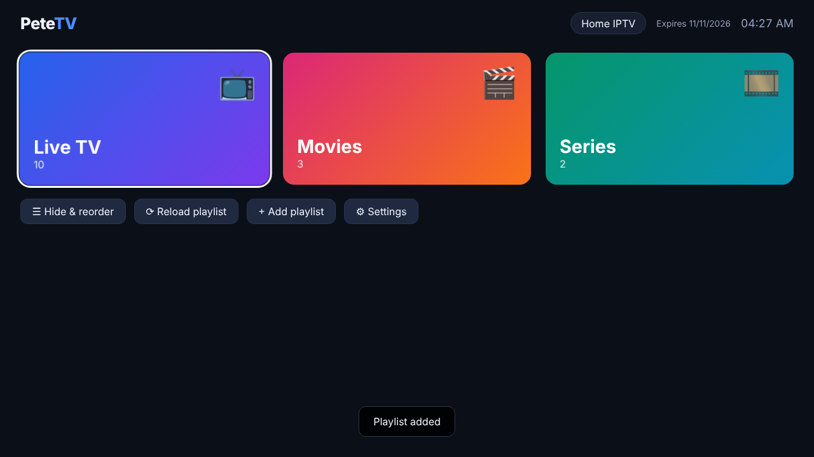
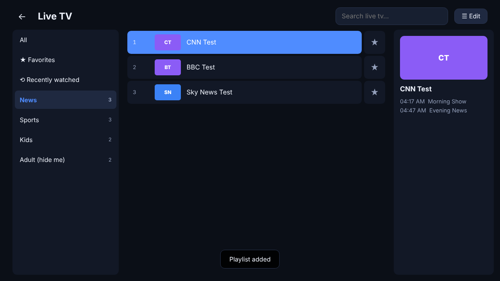
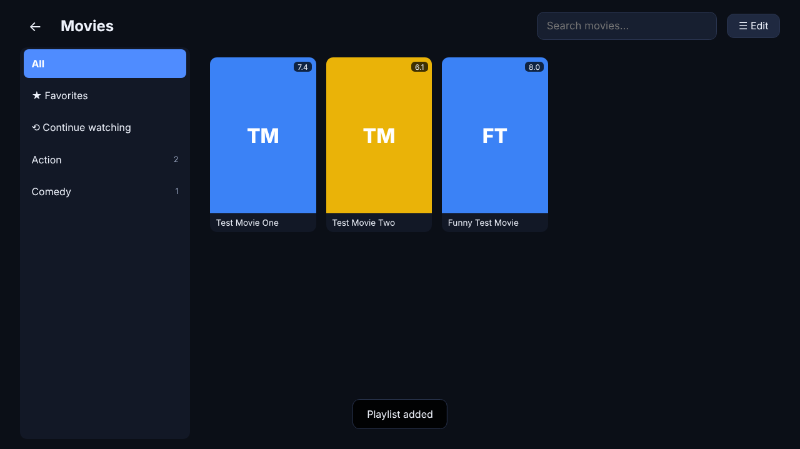
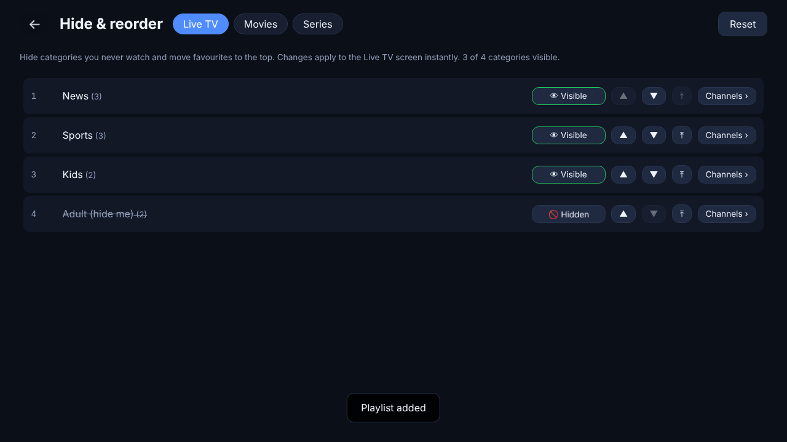

# PeteTV

**Free, open-source IPTV player for Android TV, Amazon Fire TV and the web** (iOS / Apple TV planned).
Bring your own playlist — M3U or Xtream Codes — and watch Live TV, Movies and Series with a remote-friendly UI.

No accounts. No MAC-address activation. No cloud. Your playlists stay on your device.

<p align="center">
  
  
  
  
</p>

## Features

- **Playlists:** M3U / M3U8 by URL or file upload, and **Xtream Codes** login (server + username + password). Multiple playlists, switch any time. An Xtream `get.php` M3U link is automatically upgraded to the faster Xtream API.
- **Live TV, Movies, Series** sections with categories, search, favorites, recently watched and *Continue watching* (resume where you stopped).
- **Hide & reorder** categories *and* individual channels/movies/series, with search and Select all / Deselect all (applies to the search results when searching). Stored per playlist, survives playlist refreshes (new provider categories just appear at the end).
- **TV Guide (EPG):** timeline grid from your provider's XMLTV guide (Xtream `xmltv.php`, the M3U's `url-tvg`, or a custom guide URL; `.xml.gz` supported). Parsed in the background and cached, keeping only your channels — tested with a 224 MB guide.
- **Buffer size** setting: Fast zapping / Normal / Large / Very large.
- **Live TV extras:** channel zapping with ↑/↓ or CH+/CH− inside the player, now/next programme info (Xtream short EPG).
- **Series:** seasons and episodes (from the Xtream API, or auto-grouped from `Show S01 E02` names in M3U files), auto-play next episode.
- **Built for TV remotes:** full D-pad navigation with a big focus ring; also works with mouse, keyboard and touch.
- **"Set up from phone"** (TV app): instead of IBO-style MAC activation, the TV shows a QR code + PIN; open it on your phone (same Wi-Fi) and type or upload your playlist there. Nothing leaves your network.
- **Lightweight:** ~35 KB (gzipped) UI, virtualized lists (tested with 50,000 channels: 19 MB JS heap, ~250 DOM nodes), native hardware-decoded playback on Android (Media3/ExoPlayer: HLS, MPEG-TS, MP4, MKV). APK is ~6 MB.
- **Web version:** run the same app on your own server; a built-in proxy makes provider streams playable in the browser.

> PeteTV is only a player. It does not include, sell or link to any channels or content.

## Install

### Fire TV / Fire Stick
1. Settings → My Fire TV → Developer options → turn on **Install unknown apps** for *Downloader* (install the free *Downloader* app from the Amazon store first).
2. In Downloader, enter the APK link from the [latest release](../../releases/latest):
   `https://github.com/panagiotis1226/petetv-viewer/releases/latest/download/PeteTV.apk`
3. Install → Open. PeteTV appears in *Your Apps & Channels*.

### Android TV / Google TV / Android boxes / phones
Download `PeteTV.apk` from the [latest release](../../releases/latest) and install it (e.g. with *Downloader*, *Send Files to TV*, a USB stick, or `adb install PeteTV.apk`). It shows up in the TV launcher (Leanback banner included).

Requirements: Android 7.0+ (Fire OS 6+, i.e. Fire TV Stick 2nd gen (2016) and newer).

### Web (self-hosted)
```bash
docker run -d -p 8080:8080 -e APP_PASSWORD=change-me ghcr.io/panagiotis1226/petetv-viewer:latest
```
or without Docker (Node 20+):
```bash
npm ci && npm run build
APP_PASSWORD=change-me npm run serve      # http://localhost:8080
```
| Variable | Default | Purpose |
|---|---|---|
| `PORT` | `8080` | HTTP port |
| `APP_PASSWORD` | *(empty)* | Require a password (HTTP Basic auth). **Set this if the server is reachable from the internet** — otherwise anyone can use your bandwidth through the stream proxy. |
| `ALLOW_PRIVATE_NETWORKS` | `false` | Let the proxy reach LAN/localhost addresses (e.g. a local tvheadend). Off by default to prevent SSRF. |
| `PROXY_ALLOWED_HOSTS` | *(empty)* | Optional comma-separated allow-list of provider hostnames. |

Put it behind HTTPS (Caddy, nginx, Traefik…) for public use. The server is stateless: playlists and logins are stored in each viewer's browser (IndexedDB), the server only relays requests. Streams are relayed through the server, so it uses bandwidth equal to what viewers watch.

## Using it

| Remote / keyboard | Lists | Player (live) | Player (movies/series) |
|---|---|---|---|
| Arrows / D-pad | move focus | ↑/↓ change channel | ←/→ seek 10 s |
| OK / Enter | open / play | show controls / pause | show controls / pause |
| Back / Esc | go back (twice on Home to exit the TV app) | exit player | exit player (position saved) |
| CH+ / CH− | | change channel | previous/next episode |

- **Hide & reorder:** Home → *Hide & reorder*, or *☰ Edit* in a section. Toggle 👁 to hide, ▲/▼ to move, ⤒ to move to top, *Channels ›* to edit inside a category.
- **Favorites:** ★ next to a channel, or *☆ Favorite* on a movie/series page.
- **Settings:** switch/edit/reload playlists, live stream format (MPEG-TS vs HLS — switch if channels don't start), web proxy mode.

## Architecture (why this stack)

One TypeScript + [Preact](https://preactjs.com) codebase drives every platform:

```
            ┌──────────────────── src/ (TypeScript + Preact UI, ~35 KB gz) ───────────────────┐
            │ M3U parser · Xtream client · library/prefs store (IndexedDB) · D-pad navigation │
            └──────────────┬───────────────────────────┬──────────────────────────┬───────────┘
                           │                           │                          │
             Android TV / Fire TV (Capacitor)     Web browser               iOS / tvOS (planned)
             • native Media3/ExoPlayer player     • server/: zero-dep        • Capacitor iOS +
             • native downloads (no CORS)           Node proxy (CORS,          AVPlayer plugin
             • LAN phone-setup server               mixed content, HLS       • tvOS needs a
                                                    rewrite, Range)            native shell
                                                  • hls.js / mpegts.js
```

- **Why not Flutter / React Native?** Both are heavier on low-end sticks and neither gives a first-class web build with the same UI. A web UI in the system WebView is light, and the expensive part — video decoding — is done natively by ExoPlayer, which is what makes playback smooth on a Fire Stick.
- **iOS later:** `npx cap add ios`, then implement the same `PeteTV` plugin interface (`play`, `download`) with AVPlayer/URLSession. The UI needs no changes. Apple TV (tvOS) isn't supported by Capacitor/WKWebView, so it would need a small native SwiftUI shell — see [docs/PLAN.md](docs/PLAN.md).

More detail: [docs/PLAN.md](docs/PLAN.md).

## Development

```bash
npm ci
npm run mock              # fake Xtream/M3U provider on :9090 (user demo / pass demo), needs ffmpeg
ALLOW_PRIVATE_NETWORKS=true npm run serve   # web server + proxy on :8080 (after npm run build)
npm run dev               # Vite dev server with hot reload (proxies /api to :8080)

npm run typecheck
npm test                  # unit tests (parser, Xtream client, ordering, proxy/SSRF)
npm run test:e2e          # Playwright: real playback, D-pad navigation, hide/reorder (needs Google Chrome or CHROME_PATH)
```

### Android build
Requires JDK 21 and the Android SDK (`ANDROID_HOME`).
```bash
npm run apk:release       # -> android/app/build/outputs/apk/release/app-release.apk
```
Signing: by default builds are signed with the **development key in `android/keystore/`** (public, so anyone's test builds can update each other). For builds you distribute, create your own key and set `PETETV_KEYSTORE`, `PETETV_KEYSTORE_PASSWORD`, `PETETV_KEY_ALIAS`, `PETETV_KEY_PASSWORD` (in CI: secrets `PETETV_KEYSTORE_BASE64` + the three passwords). Android only installs updates signed with the same key, so switching keys means uninstalling once.

```bash
keytool -genkeypair -keystore release.jks -alias petetv -keyalg RSA -keysize 2048 -validity 10000
base64 -w0 release.jks   # -> GitHub secret PETETV_KEYSTORE_BASE64
```

### Releases
Bump `version` in `package.json`, then either push a tag like `v0.1.0`, or run the **CI / Release** workflow manually (Actions tab → Run workflow → tick *release*). GitHub Actions runs all tests, builds the APK, attaches `PeteTV.apk` to a GitHub Release and publishes the Docker image to `ghcr.io`.

## License
[MIT](LICENSE). Contributions welcome.
